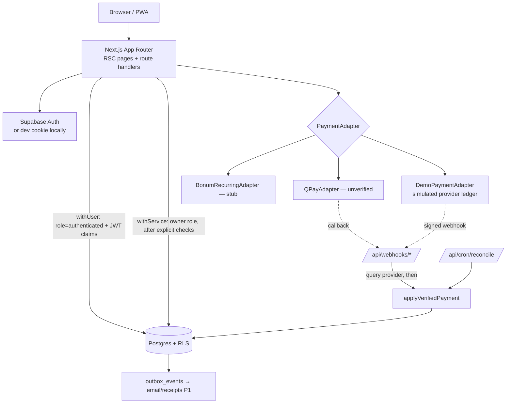
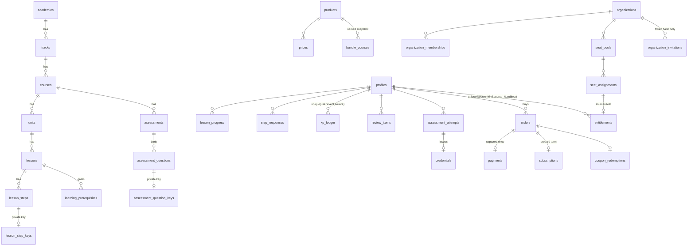

# Architecture

## 1. Product summary

Skills Academy is a Mongolian-first, multi-academy learning PWA. It launches with a **Social Media Marketing** course (5 lesson levels + a final certification level; levels 1–3 free) on a platform built for an all-access subscription across many academies, plus B2B seat licensing.

### Verified facts vs assumptions

| Item | Status |
|---|---|
| Schema, RLS, learning/payment/exam/org logic | **Verified by tests in this repo** (unit + integration against real PostgreSQL 16, E2E in Chromium) |
| Demo payment flow | Verified, but it is a **simulation**. No real money moves. Demo grants and credentials are flagged `is_demo` and labelled "ДЕМО" everywhere |
| QPay v2 adapter | **Not verified.** Draft based on the publicly described v2 flow; developer.qpay.mn could not be reached from the build environment. Refused in production until `QPAY_CONTRACT_VERIFIED=true` |
| Bonum recurring cards | **Not implemented.** Stub only, pending a merchant contract |
| Supabase Auth integration | Code path written against `@supabase/ssr`. Not exercised against a live Supabase project here; E2E uses `AUTH_MODE=dev` |
| Prices (29,900 / 249,000 / 299,000 MNT …) | Test prices from the founder brief. Not validated |
| 10% VAT shown as "included" | Assumption. Must be confirmed with an accountant |
| 300k addressable audience, conversion, CAC | Unvalidated founder hypotheses. Nothing in the code depends on them |
| Meta objective names in the lessons | Accurate to the author's knowledge. Meta changes its UI often, so a subject expert must review before launch (`courses.reviewed_at`) |

## 2. System shape (modular monolith)

### Data access rule
There are only two DB entry points (`src/lib/db/client.ts`):

- **`withUser(userId, fn)`** runs a transaction as the Postgres role `authenticated` (or `anon`) with Supabase-identical `request.jwt.claims`. Every learner-facing read goes through RLS, exactly as a Supabase client would.
- **`withService(fn)`** runs as the owner role and bypasses RLS. It is used only for state transitions: scoring, XP, orders, payments, entitlements, credentials and seats. It always comes after explicit authorization checks in the service.

The `authenticated` role has **SELECT-only** grants, plus column-limited UPDATE on its own profile and INSERT on its own analytics events. A bug that writes entitlements through `withUser` fails with *permission denied*.

### Modules (`src/features`)
| Module | Responsibility |
|---|---|
| `catalog` | academies, tracks, courses, plans, profile |
| `learning` | course map, lesson player data, server scoring, XP ledger, streaks, spaced review |
| `entitlements` | read model and a pure resolver that mirrors `has_premium_access()` |
| `commerce` | pricing, coupons, orders, payment adapters, webhooks, the verified-payment processor, refunds |
| `assessments` | certification gate, attempts, server-side exam scoring |
| `credentials` | issuance (inside the exam transaction), public verification, revocation, PDF |
| `organizations` | dashboard, seats, invitations, member removal, CSV report |
| `admin` | CMS step editing with key validation, course version publishing, audit |
| `analytics` | allow-listed, privacy-safe product events |

## 3. ER diagram (core)

All migrations are in `supabase/migrations/`. Notable refinements over the brief:
- Answer keys live in separate tables (`lesson_step_keys`, `assessment_question_keys`) that have **no client grant at all**.
- `orders` is single-line (product, price, quantity) with CHECK constraints on `subtotal = unit × qty` and `total = subtotal − discount`. A partial unique index allows only one pending order per buyer and price.
- `payments` has a unique index on `order_id` (an order can be captured once) and on `(provider, provider_payment_id)`.
- `entitlements` has a unique constraint on `(source_kind, source_id, subject_user_id)`, so a payment can only grant once.
- `credentials` has a partial unique index allowing one valid credential per user per course. Public lookup uses a random `public_id`; the sequential `credential_number` is for display.
- `platform_roles` replaces the generic `roles`/`user_role_assignments`. Org roles live in `organization_memberships`.

## 4. Permission matrix

| Resource | anon | learner (own) | other learner | org member | org manager (own org) | other org manager | platform admin (server) |
|---|---|---|---|---|---|---|---|
| Published catalog / lessons list | R | R | — | — | — | — | via service |
| Free lesson steps | R | R | — | — | — | — | — |
| Premium lesson steps | ✗ | R if entitled | ✗ | R if seat | — | — | — |
| Answer keys / question bank | ✗ | ✗ | ✗ | ✗ | ✗ | ✗ | service only |
| Progress, responses, XP, reviews | ✗ | R | ✗ | ✗ | aggregate only (`org_member_progress`) | ✗ | — |
| Orders, payments, entitlements, subscriptions | ✗ | R | ✗ | — | ✗ | ✗ | service |
| Write entitlements / orders / XP | ✗ | ✗ | ✗ | ✗ | ✗ | ✗ | service only |
| Organization row | ✗ | — | — | R | R | ✗ | — |
| Memberships | ✗ | own row | ✗ | own row | R (own org) | ✗ | — |
| Seat pools / invitations | ✗ | — | — | ✗ | R; write via service | ✗ | — |
| Credentials table | ✗ | R own | ✗ | — | number only via report | ✗ | revoke via service |
| `verify_credential(public_id)` | ✓ minimal fields | ✓ | ✓ | ✓ | ✓ | ✓ | — |
| Admin CMS | ✗ | ✗ | ✗ | ✗ | ✗ | ✗ | DB-checked `platform_roles` |

## 5. Key flows

**Free → premium → exam**
1. Server scores each step submission against the private key. XP is granted once per source.
2. `completeLesson` requires every scored step to have been answered correctly at some attempt. The lesson score is the first-attempt score.
3. Lesson 4 is premium. RLS hides its steps, the services raise `premium_required` (HTTP 402), and the page redirects to `/unlock`.
4. Plan → `POST /api/orders` → server price → provider invoice → `/checkout/[id]` shows the authoritative DB status.
5. Webhook or poll → **query the provider** → `applyVerifiedPayment` (row lock, amount check, payment row, entitlement, outbox).
6. Exam: requires an entitlement, all lessons done, no open attempt and no cooldown. Questions are drawn randomly and served without keys. Scoring is server-side with floored percentages. If passed, the credential is issued in the same transaction.

**Monthly / yearly plans** are sold as **prepaid fixed terms that do not auto-renew** (`auto_renew=false`, `next_bill_at=null`). QR invoices are not recurring debits. Buying again while active extends from the current end.

**Expiry** locks new premium activity. Progress, XP and credentials remain.

**Seat revocation** revokes the seat entitlement only. The learner keeps their progress and credentials.
